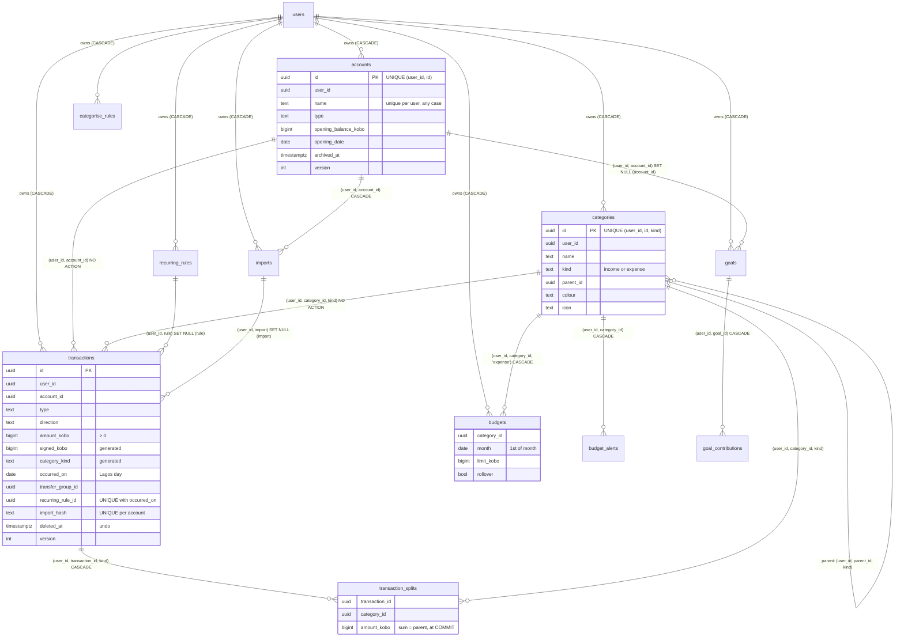
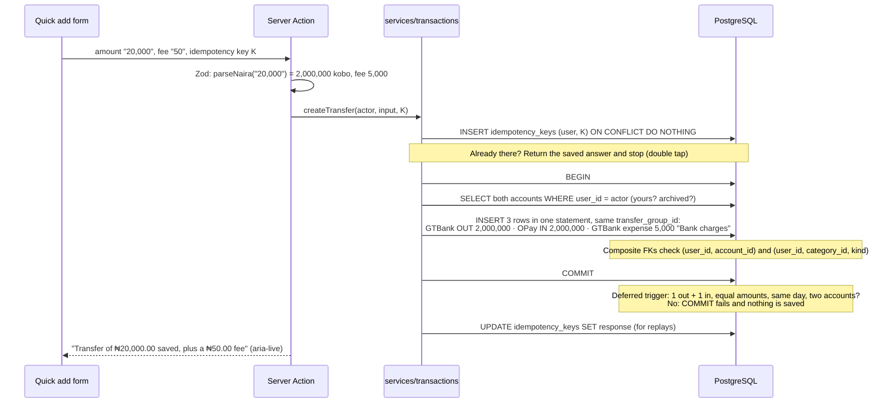
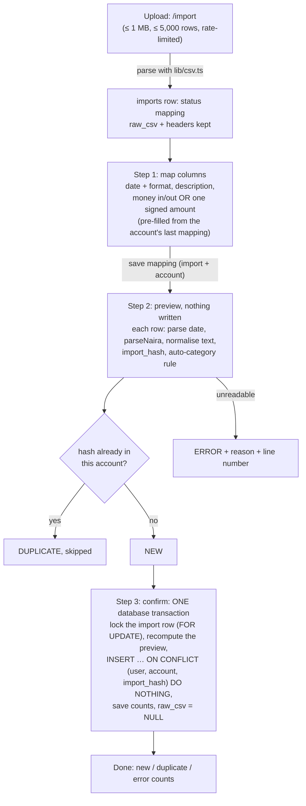

# Àpò: a private money ledger

**Àpò** (Yoruba for “pouch” or “purse”) tracks money that sits in several places at once: a bank account, a fintech wallet (OPay, Moniepoint, Kuda), cash and savings. You record income, spending and transfers, split one payment across categories, set monthly budgets, set up recurring entries (salary, rent, data, DSTV, ajo), save towards goals, import a bank statement CSV and read reports.

Everything is private. No other user can see your money, and neither can an admin.

Day 21 of a 30-day challenge. The focus is **transactions and budgets**:
- keeping money exact
- database transactions that write several rows
- constraints the database checks at COMMIT
- ownership enforced by composite foreign keys
- reports built with SQL aggregation

Stack:
- Next.js 16.4 (App Router, Cache Components) with TypeScript (strict, `noUncheckedIndexedAccess`, `erasableSyntaxOnly`)
- Tailwind CSS v4
- PostgreSQL on Neon through `@neondatabase/serverless`, in plain parameterised SQL with numbered migrations
- Zod
- Resend
- Hand-built SVG charts

There is no ORM, and no auth, UI, form, chart or state library.

## Contents

- [Run it locally](#run-it-locally)
- [Deploy to Vercel](#deploy-to-vercel)
- [Signing in](#signing-in)
- [The three diagrams](#the-three-diagrams)
- [How money is kept exact](#how-money-is-kept-exact)
- [How transfers and splits stay consistent](#how-transfers-and-splits-stay-consistent)
- [Balances are derived, never stored](#balances-are-derived-never-stored)
- [Budgets, rollover and “safe to spend”](#budgets-rollover-and-safe-to-spend)
- [Recurring entries](#recurring-entries)
- [CSV import without duplicates](#csv-import-without-duplicates)
- [Reports: SQL aggregation](#reports-sql-aggregation)
- [Time is Lagos time](#time-is-lagos-time)
- [Ownership: two layers, and why not three](#ownership-two-layers-and-why-not-three)
- [Privacy: why even an admin can’t see your money](#privacy-why-even-an-admin-cant-see-your-money)
- [The schema: tables, constraints, ON DELETE, indexes](#the-schema-tables-constraints-on-delete-indexes)
- [EXPLAIN output](#explain-output)
- [Design and accessibility](#design-and-accessibility)
- [What changed when reusing the Day 17 auth](#what-changed-when-reusing-the-day-17-auth)
- [Checks and verification](#checks-and-verification)
- [Concepts and where they live](#concepts-and-where-they-live)
- [Not built (yet)](#not-built-yet)

## Run it locally

You need Node 22.18 or newer and a free [Neon](https://neon.tech) project.

```bash
npm install
cp .env.example .env.local     # then fill it in (below)
npm run db:migrate             # applies db/migrations/001…012, each in its own transaction
npm run db:seed                # a user with a year of data, and an admin (safe to run twice)
npm run dev                    # http://localhost:3021
```

**`.env.local`:**

| Variable | What it is |
|---|---|
| `DATABASE_URL` | Neon → Connect → **pooled** connection string (the host contains `-pooler`). |
| `APP_URL` | `http://localhost:3021` locally. Every email link is built from it, never from the request’s Host header. |
| `RESEND_API_KEY` | Optional. Without it, every email (verification, password reset, budget warnings) is printed in the terminal. |
| `EMAIL_FROM` | e.g. `Àpò <onboarding@resend.dev>`. Resend’s test sender only delivers to your own address until you verify a domain. |
| `CRON_SECRET` | A long random string: `node -e "console.log(crypto.randomBytes(32).toString('hex'))"`. |
| `SEED_USER_PASSWORD`, `SEED_ADMIN_PASSWORD` | Passwords for the two seeded accounts, 8–128 characters. They are read from here, never written in code. |

**Other scripts:**

| Command | What it does |
|---|---|
| `npm run check:money` | Runs the real services against the database and prints PASS or FAIL for each money rule ([below](#checks-and-verification)). |
| `npm run check:contrast` | Checks every text and UI colour pair in both themes against WCAG AA. |
| `npm run db:explain` | Prints `EXPLAIN (ANALYZE, BUFFERS)` for the main queries. |
| `npm run typecheck`, `npm run lint`, `npm run build` | Type-check, lint and build. |

## Deploy to Vercel

1. Push the repo to GitHub and import it in Vercel (framework preset: Next.js).
2. Under **Settings → Environment Variables**, add every variable from the table above:
   - `DATABASE_URL`
   - `APP_URL` (your `https://….vercel.app` address)
   - `RESEND_API_KEY` and `EMAIL_FROM`
   - `CRON_SECRET`
   - The `SEED_*` passwords are only needed if you run the seed against that database.
3. Deploy, then run the migrations once against the production database from your machine: `DATABASE_URL=… npm run db:migrate`.
4. **The cron job.** `vercel.json` schedules `GET /api/cron/recurring` daily at 05:00 UTC (06:00 in Lagos). Vercel sends `Authorization: Bearer $CRON_SECRET` automatically when that variable is set; any other caller gets 401. Each run does five things, and each is safe to run twice:
   - creates the due recurring entries for every user;
   - purges soft-deleted transactions past their undo window;
   - deletes demo users older than 24 hours, with everything they own;
   - deletes idempotency keys older than 24 hours;
   - cancels abandoned statement uploads, deleting the file.

   Each run is logged, with counts only, in `cron_runs` and shown on `/admin`. Pick a Vercel region next to your Neon region (e.g. Frankfurt, `fra1`, for `eu-central-1`).

## Signing in

| Who | How | Password |
|---|---|---|
| A year of sample data | `seed.user@apo.example` | `SEED_USER_PASSWORD` from `.env.local` |
| Admin (counts and health only) | `seed.admin@apo.example` | `SEED_ADMIN_PASSWORD` from `.env.local` |
| A demo, just for you | **Try the demo** on the home page | none |

**Try the demo** is a POST form, never a link, so crawlers and WhatsApp link previews can't create accounts. It's rate-limited to 10 an hour per IP. Each click creates an isolated user (`is_demo = true`, no password) with three months of realistic Lagos data:
- salary on the 25th, rent, transport, data, food
- transfers between accounts, and split market trips
- budgets in all three states
- recurring rules and a goal

Demo users never get email (their address is on the reserved `.invalid` domain). The banner offers **Start fresh**, which deletes that demo and makes a new one. The daily cron deletes demos after 24 hours, and `ON DELETE CASCADE` takes all their rows with them.

## The three diagrams

### 1. The schema



Also: Day 17's `sessions`, `email_tokens`, `auth_events` and `rate_limits`; `idempotency_keys` (Day 20); and `cron_runs`. The view `category_lines` turns every non-transfer, non-deleted transaction into one line per category (its splits, or itself). Budgets and every report read only that view.

### 2. Recording a transfer (GTBank → OPay ₦20,000, ₦50 fee)



Result: GTBank −₦20,050 and OPay +₦20,000, so the total balance drops by ₦50, which is the fee. The transfer itself is not spending, and the fee is.

### 3. The CSV import flow



## How money is kept exact

**Every amount is a whole number of kobo in a `bigint` column.** There is no `numeric`, no `real` and no JavaScript float anywhere money is stored, added or compared.

Why not floats? Binary floating point can't hold 0.1 exactly, so:

```
0.1 + 0.2   → 0.30000000000000004
1.15 * 100  → 114.99999999999999   (Math.floor gives 114 kobo, one kobo lost)
```

In a ledger that error doesn't stay small:
- a balance is the sum of thousands of rows;
- a split has to equal its payment exactly;
- "₦0.00 left" is an equality test.

Integer addition is exact, and so is integer kobo.

- **Parsing is done on strings** ([`lib/money.ts`](lib/money.ts)). `parseNaira("₦12,500.5")`:
  1. strips `₦`, `NGN` and spaces;
  2. checks the shape against a strict pattern: commas only in proper groups of three, at most two decimals;
  3. reads the Naira and kobo parts as two whole numbers and joins them with `BigInt`, never multiplying a float by 100.

  It rejects `-0.01` (a form amount is never negative: the TYPE says in or out), `0`, `1.005` and `12,50`. Bank columns use `parseSignedNaira`, which understands `-4,500.00`, `(4,500.00)`, `4,500.00 DR` and `4,500.00 CR`.
- **Display** uses `Intl.NumberFormat("en-NG", { style: "currency", currency: "NGN" })`. It's fed a decimal *string* built from kobo with BigInt, so formatting never rounds. Every amount carries a sign: `+₦250,000.00` and `−₦4,500.00` (the real minus, U+2212, as wide as `+` in tabular figures).
- **Why `number` in TypeScript, not `bigint`?** A JS number holds every integer exactly up to 2⁵³ kobo (about ₦90 trillion). Rows are parsed with Zod (`int8` in [`lib/rows.ts`](lib/rows.ts)), which refuses anything past `Number.isSafeInteger`.
- **Division happens only for display**, in integer kobo with an explicit rounding direction. "Safe to spend today" and "average daily spend" round DOWN, because promising half a kobo you don't have is the wrong way to round.

**A dollar domiciliary account** isn't built. It would need these changes:
- `currency char(3)` on `accounts` (and on each transaction, copied from its account);
- amounts in each currency's minor unit (cents);
- a transfer between a dollar and a naira account becomes two amounts plus an exchange rate, so the "equal amounts" rule in the transfer trigger becomes "each leg in its own account's currency";
- totals, budgets and net worth need a reporting currency and dated rates (a `fx_rates` table), and must say which rate they used;
- `Intl.NumberFormat` takes the account's currency.

## How transfers and splits stay consistent

- **One database transaction per change.** `withTransaction` ([`lib/db/tx.ts`](lib/db/tx.ts)) is an interactive `BEGIN … COMMIT` over the Neon WebSocket pool. Throw anything and everything is rolled back:
  - a transfer's 2–3 rows;
  - a split's parent and lines;
  - an import's hundreds of rows;
  - a goal contribution and its transfer.
- **Deferred constraint triggers** ([`009_transactions.sql`](db/migrations/009_transactions.sql)):
  - `transaction_splits_sum`: the split lines add up exactly to the transaction.
  - `transactions_transfer_pair`: a transfer group has exactly one `out` and one `in` row, the same amount, the same day, two different accounts, both live or both deleted.

  **Why a normal CHECK can't do this:** a CHECK sees one row, but these rules are about several rows (in two tables, for splits). An ordinary trigger would fire after each statement, and in the middle of every correct save the rule is briefly false: the parent exists before its splits, and one transfer leg before the other. `DEFERRABLE INITIALLY DEFERRED` queues the checks until `COMMIT`, when the whole group is in place. If the check fails then, the entire transaction is undone. It applies to every writer: the app, the import, the seed and `psql`. `npm run check:money` proves both.
- **Editing a transfer** updates both halves and the fee in one transaction, guarded by the out-half's `version`. **Deleting one** soft-deletes every row in its group in one `UPDATE`.
- **Optimistic concurrency.** Each editable row has `version`. An edit runs `UPDATE … WHERE id = $1 AND version = $loaded RETURNING version`. If another tab or your phone saved first, it matches nothing, and the form shows *"changed in another tab"* with the latest saved values, rather than silently overwriting them.
- **Idempotency: a double tap saves once.** Every quick-add form carries a random key made by the server when the page rendered. The service claims `(user, operation, key)` in `idempotency_keys` *before* saving, and the UNIQUE index is the referee. A second submit with the same key (double tap, a retry on a slow network) finds the claim and gets the first answer back: *"Already saved: that was sent twice and recorded once."* A successful save hands the form a fresh key for the next entry.
- **Delete with Undo.** Deleting sets `deleted_at`, so the row leaves every list, balance and report at once.
  - An Undo bar (aria-live, pauses on hover or focus) offers restore for 8 seconds; the server accepts a restore for 10 minutes.
  - The purge removes deleted rows after that, lazily on the next dashboard load and in the daily cron.
  - The Undo bar sits *above* the list, so it survives the row disappearing when the page refreshes.

## Balances are derived, never stored

`balance = opening_balance_kobo + SUM(signed_kobo)` over the account's live transactions. `signed_kobo` is a **generated column** (`+amount` for in, `−amount` for out) that nothing can write.

**What a stored running balance would risk:**
- Two records of one fact can disagree.
- Every edit, delete, undo and import must remember to adjust it.
- Two saves at once can both read ₦10,000 and each write its own result (a lost update).
- One forgotten code path, or one hand fix in the database, and the balance is wrong forever, with no record of what it should be.

A derived balance is recalculated from the ledger every time, so it can't drift.

**Speed:** the partial covering index `transactions_account_list_idx (user_id, account_id, occurred_on DESC, created_at DESC, id DESC) INCLUDE (signed_kobo) WHERE deleted_at IS NULL` lets the SUM be an **index-only scan** ([plan 3](#explain-output): 238 rows in 0.1 ms). The account page's running balance is a window function over that same index:

```sql
SUM(signed_kobo) OVER (ORDER BY occurred_on, created_at, id ROWS UNBOUNDED PRECEDING)
```

At millions of rows per account, the next step would be monthly snapshots (still derived and rebuildable), never a hand-edited balance.

## Budgets, rollover and “safe to spend”

[`lib/repos/budgets.ts`](lib/repos/budgets.ts) and [`lib/services/budgets.ts`](lib/services/budgets.ts):

- **Spent** for a month is the sum of `category_lines` in the budget's category **or any of its sub-categories**. Split lines count per split, and transfers never count. The month is `[1st, 1st of next month)` compared with `occurred_on`, a Lagos date. Budgets live on top-level categories only: a budget on "Market" *and* "Food & groceries" would count the same naira twice.
- **States**, each with a word and a glyph, never colour alone:
  - **● On track** below 80%;
  - **▲ 80% used** (ochre) from 80%;
  - **■ Over budget** (brick red) past 100%.

  They're compared in integer kobo (`spent × 100 ≥ available × 80`), with no division.
- **Rollover in SQL.** With rollover on, `carry(M) = limit(M−1) + carry(M−1) − spent(M−1)`. That's recursive, but it unrolls to the **sum of (limit − spent) over the earlier months of the same unbroken run**. A run breaks where rollover is off or a month has no budget. The query finds runs with the *gaps-and-islands* pattern:
  1. `lag(month) OVER (PARTITION BY category ORDER BY month)` marks where a run starts;
  2. a running `SUM(starts_run)` numbers the runs;
  3. `SUM(limit − spent) OVER (PARTITION BY category, run ORDER BY month ROWS BETWEEN UNBOUNDED PRECEDING AND 1 PRECEDING)` adds up the earlier months only.

  The carry is never stored, so editing a September expense corrects October's carry.
- **Safe to spend today** = what's left across this month's budgets ÷ days left in the Lagos month, counting today. On the 31st that's 1 day, never 0.
- **"Copy last month's budget"** is one `INSERT … SELECT … ON CONFLICT (user, category, month) DO NOTHING`. Pressing it twice copies nothing the second time, and categories already budgeted keep their limits.
- **Warning emails, once.** After an expense is saved, the service checks this month's budgets and `INSERT`s into `budget_alerts (user, category, month, 80|100) ON CONFLICT DO NOTHING RETURNING`. An email goes only when a row actually came back. The emails are sent with `after()`, once the response has gone, and the words are announced in the form's live region.

## Recurring entries

[`lib/services/recurring.ts`](lib/services/recurring.ts) and [`lib/recurrence.ts`](lib/recurrence.ts):

- **"Both", as on Day 20.** Due entries are created **lazily** when you open the dashboard, transactions, budgets or recurring page, and by the **daily cron** for people who don't open the app. The two can run at the same instant.
- **Idempotent by construction:** `UNIQUE (recurring_rule_id, occurred_on)` on `transactions`, and every run inserts with `ON CONFLICT DO NOTHING`. Checking "does it exist?" in code would leave a gap where two runs both see "no"; a unique index can't be raced. `next_run_on` is advanced with a guarded `UPDATE … WHERE next_run_on = $read`. Soft-deleted rows still count, so deleting this month's rent doesn't make the next run recreate it.
- For a transfer rule only the **out** half carries `recurring_rule_id` (a CHECK enforces this). Its insert decides whether the run owns that date.
- **The short-month rule:** a rule keeps its anchor day.
  - The 31st falls on the **last day of shorter months** (30 April, 28 or 29 February) and goes back to the 31st in May.
  - A 29 February yearly rule falls on 28 February in other years.

  Skipping the month would lose a rent payment, and rolling over to the 1st would put two in one month.
- **Pausing** creates nothing. **Resuming** moves to the next date on or after today, without back-filling the paused months.
- The dashboard's **"Upcoming in the next 7 days"** expands each rule's dates (weekly rules can appear twice).

## CSV import without duplicates

[`lib/csv.ts`](lib/csv.ts), [`lib/statement.ts`](lib/statement.ts) and [`lib/services/imports.ts`](lib/services/imports.ts):

- **The parser** is hand-written (~80 lines) rather than PapaParse. Bank exports are plain RFC 4180, and the parser is worth reading because "split on commas" is the classic bug. It handles:
  - commas and newlines inside quotes, and `""` escapes;
  - CRLF line endings and Excel's byte-order mark;
  - `;` or tab delimiters;
  - a cut-off file, which it reports.
- **Dates** come in the formats Nigerian banks use: `DD/MM/YYYY` (GTBank, Access), `DD-MMM-YYYY` (Zenith, UBA) and `YYYY-MM-DD`. **`03/04/2026` is ambiguous**: 3 April here, 4 March in the US.
  - Any day above 12 in the file settles it.
  - Otherwise the mapping step says *"Check this one"*, defaults to day-first, and shows how the first dates read in *each* format ("03/04/2026 → 3 Apr 2026") so you choose.
  - Impossible dates such as 30/02 are rejected, as are future dates.
- **Duplicates.** `import_hash = sha256(account | date | signed kobo | normalised description | nth repeat in the file)` with `UNIQUE (user_id, account_id, import_hash)`. Normalising means upper case, punctuation dropped and spaces collapsed. The **nth repeat** keeps two genuine identical ₦100 MTN airtime buys on one day as two rows, while a re-import produces exactly the same hashes. Importing the same statement twice adds nothing; the sample does exactly that in `check:money`.
- **Auto-categorisation rules** ("contains BOLT|UBER → Bolt & ride-hailing", "MTN|AIRTEL|GLO → Data & airtime") are editable on `/settings/rules`. They apply during the preview, and a rule only matches money moving its way.
- **Limits:** 1 MB, 5,000 rows, 30 uploads an hour.
  - The file lives in `imports.raw_csv` only between upload and confirm, then it's set to NULL.
  - The cron deletes it from uploads abandoned for a day.
  - The mapping is remembered on the account for its next statement.
- **Sample:** [`/public/samples/gtbank-statement-sep-2026.csv`](public/samples/gtbank-statement-sep-2026.csv) has 16 rows. It includes quoted commas, an escaped quote, two identical airtime purchases, and one unreadable amount on purpose.

## Reports: SQL aggregation

[`lib/repos/reports.ts`](lib/repos/reports.ts). Every number comes from one SQL query; nothing is summed in JavaScript.

- **Monthly cash flow** for the last 12 months uses `generate_series(from, to, '1 month')` LEFT JOINed to the grouped sums. **Why:** `GROUP BY` only makes groups for months that *have* rows, so a month with no transactions would simply vanish, and the bar chart would draw January next to March. The series supplies every month and `coalesce` turns "no row" into ₦0.
- **Spending by category** for a month, with month-over-month change. Sub-categories are rolled up with `coalesce(parent_id, id)`, and `FILTER (WHERE …)` produces both months from one scan.
- **Net worth over time** is a **window function**: `sum(change) OVER (ORDER BY month ROWS UNBOUNDED PRECEDING)`. For each month row, it adds this row's change and every earlier row's. Unlike `GROUP BY`, which squashes rows into one, a window keeps every row and adds a column:

  | month | change | net worth |
  |---|---|---|
  | Aug | +412,000 | 412,000 |
  | Sep | −18,500 | 393,500 |
  | Oct | +61,200 | 454,700 |

  The series starts at the earliest data, so the running total includes everything before the window.
- **Top payees** (grouped case-insensitively) and the **average daily spend** over the range. If the range ends this month, it counts the days up to today.
- **Bookmarkable:** `/reports?from=2025-11&to=2026-10&month=2026-10&account=…`. Every report has a **CSV** export and a text summary, and every chart has a **View as table** toggle.

## Time is Lagos time

[`lib/time.ts`](lib/time.ts). Every "today", "this month" and month boundary is Africa/Lagos (UTC+1, no daylight saving), whatever the server or phone says. Calendar dates travel as `'YYYY-MM-DD'` strings, and SQL returns them as text (`occurred_on::text`), so no time zone can shift them. `occurred_on` is a Lagos `date`; `occurred_at` keeps the exact instant when known, and a CHECK ties the two together.

**Where it matters:** a card payment at **00:30 on 1 November** in Lagos is **23:30 on 31 October** in UTC. Grouped by UTC, it would count against October's budget, and on the 1st "safe to spend" would divide October's leftovers by November's days. `check:money` asserts it lands on 1 November.

## Ownership: two layers, and why not three

**Layer 1, the services.** Every service function takes the acting user first, and every query has `WHERE user_id = $actor`. Asking for someone else's transaction, account, budget, goal, import or rule by id returns **404, not 403**. A 403 would confirm that the id exists and belongs to somebody. The list:

- **Transactions:** `getEntry`, `updateEntry`, `updateTransfer` and `deleteEntry` find nothing for another user's id. Restore only matches your own ids.
- **Writes:** before every write, `findRefs` checks that the account and categories are yours (and not archived) in one query.
- **Other ids:** accounts, budgets (by id), recurring rules, goals and contributions, imports, categories and categorisation rules all filter by `user_id`.
- **Filters and exports:** a report's `?account=` filter, CSV exports and "export all" all filter by the signed-in user's id. A foreign account id in a filter gives 404.
- **`proxy.ts`** does one indexed ownership lookup for `/accounts/<id>`, `/transactions/<id>` and `/import/<id>`, so the HTTP status is a real 404. Under Cache Components the page frame has already started streaming with 200 before `notFound()` can run (the Day 19/20 lesson).
- **The admin service** imports one repo, which never touches a money table.

**Layer 2, the database.** Every link between two of a user's rows is a **composite foreign key**:

```sql
FOREIGN KEY (user_id, account_id) REFERENCES accounts (user_id, id)
FOREIGN KEY (user_id, category_id, category_kind) REFERENCES categories (user_id, id, kind)
```

A plain `account_id REFERENCES accounts (id)` proves only that the account *exists*. The composite key proves it belongs to *the same user as the row pointing at it*. So even if a service forgot its check, filing Bola's expense against Ada's GTBank account finds no `(Bola, Ada's-account)` pair and fails with 23503. A whole class of "my data linked to yours" bugs can't be written. `check:money` tries exactly that in raw SQL.

Adding `kind` to the key also makes "salary filed under Rent" impossible. `category_kind` is a generated column copied from the transaction's type. Splits, budgets (via a constant `'expense'` column), recurring rules, sub-categories, imports and goals use the same pattern.

**A third layer, Row Level Security**, would have Postgres itself add `user_id = current_setting('app.user_id')` to every query on every table, so even a raw `SELECT * FROM transactions` with no WHERE would see one user's rows. It doesn't fit cleanly here:

- The Neon **HTTP** driver runs each query as its own transaction. To set `app.user_id`, every read would need wrapping in `BEGIN; SET LOCAL …; query; COMMIT`, which costs a WebSocket transaction (and round trips) per page.
- It needs a second, non-owner database role, because table owners bypass RLS unless `FORCE`d.
- Neon's own RLS integration expects JWTs from an auth provider, not Day 17's database sessions.

With the composite keys and the service filters, that cost buys little for one app with one service layer. It would be worth it if other code (analytics, a second service) queried the same tables directly.

## Privacy: why even an admin can’t see your money

`/admin` shows sign-up counts (a 14-day chart), verified, demo and admin counts, active sessions, the database round-trip time and the last cron runs (counts only). **There is no "view user" button, and no admin code path that can read money.**

[`lib/services/admin.ts`](lib/services/admin.ts) imports only [`lib/repos/stats.ts`](lib/repos/stats.ts), which reads `users`, `sessions` and `cron_runs`. An admin is otherwise an ordinary user who sees only their own ledger, and gets the same 404 for anyone else's account (tested). Why build it this way:

- **Trust:** people record salaries, debts and family support. Nobody should have to trust every present and future admin.
- **A phished admin password leaks counts, not ten thousand people's balances.**
- **Data minimisation** (Nigeria's NDPA 2023, the GDPR): running the service needs to know it's healthy, not what you spent at Shoprite.
- **Fewer bugs can leak:** an admin page with no money queries can't show money by mistake.
- Support works by asking the user, or by the user exporting their own data. **Delete my account** is one statement that cascades through everything.

## The schema: tables, constraints, ON DELETE, indexes

Every table, column and constraint is commented where it's defined: [`db/migrations/007`](db/migrations/007_accounts_and_categories.sql) to [`012`](db/migrations/012_idempotency_and_cron.sql).

**The tables:**

| Table | Why it exists |
|---|---|
| `accounts` | Where money sits. Holds the opening balance and date; the balance itself is derived. Archived, not deleted, once used. One name per user, ignoring case. `version` for edits. |
| `categories` | What money was for. `kind` income or expense, one level of sub-categories (a trigger forbids grandchildren), a palette colour token, an icon. Defaults are created by an `AFTER INSERT` trigger on `users`. |
| `transactions` | The ledger. A positive amount plus a direction; generated `signed_kobo` and `category_kind`. `occurred_on` is a Lagos date. `transfer_group_id`, `recurring_rule_id`, `import_id`, `import_hash`, `deleted_at` (undo), `version`. |
| `transaction_splits` | One row per category of a split payment. The sum is checked at COMMIT. |
| `budgets` | Limit per category per month (the 1st), plus `rollover`. UNIQUE (user, category, month). |
| `budget_alerts` | "This warning was sent": the primary key makes each email once-only. |
| `recurring_rules` | The template and the schedule (anchor day, `next_run_on`, `ends_on`, `paused`). |
| `imports` | One uploaded statement: the file only until confirm, the mapping, final counts, status. |
| `categorise_rules` | "Description contains X → category", in order. |
| `goals`, `goal_contributions` | A target (and optional savings account), and the amounts put towards it. Progress is the sum. |
| `idempotency_keys` | One row per (user, operation, key): the double-tap referee. |
| `cron_runs` | When the daily job ran and what it did (counts). |

**ON DELETE, chosen deliberately for each foreign key:**

| Foreign key | ON DELETE | Why |
|---|---|---|
| every `user_id → users` | CASCADE | "Delete my account and all its data" is one statement. |
| transactions → accounts, categories | NO ACTION | Used rows are archived, not deleted. NO ACTION rather than RESTRICT: NO ACTION is checked at the end of the statement, so a user delete can cascade through accounts *and* their transactions together. RESTRICT checks immediately and could refuse mid-cascade. |
| recurring_rules → accounts, categories | NO ACTION | Same: archive, don't delete. |
| splits → transactions | CASCADE | A split line means nothing without its payment. |
| transactions → recurring_rules, imports | SET NULL (column) | The entries stay, just unlinked. PG 15+'s column list nulls only that column, not the shared `user_id`. |
| goals → accounts | SET NULL (account_id) | The goal stays if its (unused) account is deleted. |
| budgets, budget_alerts, categorise_rules → categories | CASCADE | Only an unused category can be deleted; its budgets and rules go with it. |
| imports → accounts | CASCADE | Only an account with no transactions can be deleted; its abandoned uploads go too. |
| goal_contributions → goals | CASCADE | Contributions belong to their goal. |
| categories parent → categories | NO ACTION | Move the children first. |

**Indexes, each for a real query:**
1. `transactions_account_list_idx (user_id, account_id, occurred_on DESC, created_at DESC, id DESC) INCLUDE (signed_kobo) WHERE deleted_at IS NULL`: an account's list and cursor, its balance and its running balance.
2. `transactions_user_list_idx (user_id, occurred_on DESC, created_at DESC, id DESC)`: the all-accounts list and any month range.
3. `transactions_spending_idx (user_id, occurred_on) INCLUDE (type, category_id, amount_kobo, signed_kobo) WHERE … type <> 'transfer'`: per-category sums.
4. `transactions_search_idx`: a pg_trgm GIN index on `lower(payee || ' ' || note)`, so "contains bolt" (`LIKE '%bolt%'`) can use an index.
5. Indexes for the transfer group, category usage, the purge and the import foreign key.
6. The unique indexes that are rules in themselves: `(recurring_rule_id, occurred_on)`, `(user_id, account_id, import_hash)`, `(user_id, lower(name))` for accounts, and `(user_id, category_id, month)` for budgets.

## EXPLAIN output

`npm run db:explain` against the seed user (one year, 789 transactions; user ids shortened):

### 1. An account’s transactions, newest first (page 1 of the list)

```
Limit (actual time=0.008..0.032 rows=31.00 loops=1)
  Buffers: shared hit=17
  ->  Index Scan using transactions_account_list_idx on transactions t (actual time=0.007..0.029 rows=31.00 loops=1)
        Index Cond: ((user_id = '…'::uuid) AND (account_id = '…'::uuid))
        Index Searches: 1
        Buffers: shared hit=17
Planning Time: 0.283 ms
Execution Time: 0.052 ms
```

The index already holds the rows in the list's order: Postgres reads the first 31 entries and stops. There's no sort, and page 200 (by cursor) costs the same as page 1.

### 2. Spending by category for one month (Lagos month boundaries)

```
HashAggregate (actual time=0.146..0.149 rows=12.00 loops=1)
  Group Key: COALESCE(c.parent_id, c.id)
  ->  Hash Left Join (actual time=0.071..0.134 rows=54.00 loops=1)
        Hash Cond: (COALESCE(s.category_id, t.category_id) = c.id)
        ->  Hash Right Join (actual time=0.052..0.106 rows=54.00 loops=1)
              Hash Cond: (s.transaction_id = t.id)
              ->  Seq Scan on transaction_splits s (actual time=0.004..0.020 rows=172.00 loops=1)
              ->  Hash (actual time=0.041..0.042 rows=47.00 loops=1)
                    ->  Bitmap Heap Scan on transactions t (actual time=0.018..0.035 rows=47.00 loops=1)
                          Recheck Cond: ((user_id = '…'::uuid) AND (occurred_on >= '2026-10-01'::date) AND (occurred_on < '2026-11-01'::date) AND (deleted_at IS NULL))
                          Filter: ((type <> 'transfer'::text) AND (type = 'expense'::text))
                          ->  Bitmap Index Scan on transactions_user_list_idx (actual time=0.009..0.009 rows=70.00 loops=1)
                                Index Cond: ((user_id = '…'::uuid) AND (occurred_on >= '2026-10-01'::date) AND (occurred_on < '2026-11-01'::date))
        ->  Hash (actual time=0.017..0.017 rows=24.00 loops=1)
              ->  Seq Scan on categories c (actual time=0.007..0.013 rows=24.00 loops=1)
                    Filter: (user_id = '…'::uuid)
Planning Time: 0.408 ms
Execution Time: 0.189 ms
```

The index finds this user's 70 rows for the month directly. At this size the planner prefers the list index to `transactions_spending_idx`, which it will choose as months fill up. The sequential scans are on tables of a few hundred rows (all splits, all categories), where reading everything is cheaper than an index.

### 3. An account’s derived balance (opening balance + SUM of the ledger)

```
Seq Scan on accounts a (actual time=0.077..0.077 rows=1.00 loops=1)
  Filter: ((user_id = '…'::uuid) AND (id = '…'::uuid))
  SubPlan 1
    ->  Aggregate (actual time=0.063..0.064 rows=1.00 loops=1)
          ->  Index Only Scan using transactions_account_list_idx on transactions t (actual time=0.010..0.046 rows=238.00 loops=1)
                Index Cond: ((user_id = a.user_id) AND (account_id = a.id))
                Heap Fetches: 25
Planning Time: 0.160 ms
Execution Time: 0.104 ms
```

The balance is an **index-only scan**: `signed_kobo` is INCLUDEd in the index, so the 238 amounts are summed without reading the table. That's why a derived balance is cheap.

## Design and accessibility

**"A well-kept ledger book in ink blue":**
- Jordy Blue ruled lines under every row, and a double rule across the top of every card;
- ruled-paper backgrounds on the hero and empty states;
- a **perforated edge** on account cards, like a cheque-book stub (a CSS mask cuts the holes);
- **engraved** big balances: the display face filled with fine hatching in two inks, with a double underline, like banknote numerals;
- a hand-drawn **pouch** mark (an àpò gathered with a drawstring) in Oxford Blue, Lavender in dark mode, with no icon pack.

The icons (including the 21 category icons) are hand-drawn SVG paths on one grid.

**Fonts** (next/font): **Libre Bodoni** for headings and the big figures, a didone like banknote engraving; **Fira Sans** for the body, very readable at phone sizes, with **tabular figures** on every amount. Both have ₦, À ò ọ ẹ ṣ and the real minus; I checked each by parsing the font's cmap and GSUB tables. Fraunces, Source Sans 3, Figtree, Instrument Sans and Young Serif were ruled out for missing glyphs or no `tnum`.

**The palette.** Only these colours exist; `--color-*: initial` deletes Tailwind's defaults, so `bg-green-600` doesn't compile. They're defined once in the `@theme` block of [`app/globals.css`](app/globals.css):

| Token | Hex | Used for |
|---|---|---|
| Oxford Blue (`oxford`) | `#192338` | Light: main text, headings, the mark. Dark: the page. First donut shade. |
| Space Cadet (`space-cadet`) | `#1E2E4F` | Light: secondary text, the top bar and navigation. Dark: cards, panels, the bottom nav. |
| YInMn Blue (`yinmn`) | `#31487A` | Light: primary buttons, links, the active tab, chart bars, the focus ring, input borders. Dark: inputs, hover, raised surfaces. |
| Jordy Blue (`jordy`) | `#8FB3E2` | Light: **decoration only** (ruled lines, card borders, track outlines, selected rows, the empty part of charts); 1.65:1 on Lavender, so never text. Dark: primary buttons, links, the active tab, chart bars, the focus ring. |
| Lavender (`lavender`) | `#D9E1F1` | Light: the page, the inside of inputs and progress tracks. Dark: main text (secondary at 78%). Text on light-mode buttons. |
| Card tint (`tint`) | `#EEF2F9` | Light: cards and panels (a lighter Lavender). |
| Money in (`money-in`) | `#1D6B47` / dark `#86D3A8` | `+` amounts only. |
| Money out (`money-out`) | `#A1353A` / dark `#F2A7A7` | `−` amounts and "Over budget" only. |
| 80% used (`warn`) | `#835A0B` / dark `#E9C46A` | The "80% used" budget state only. |

The status colours are kept for money and budgets: form errors and delete buttons use ink, the ✕ glyph and a heavy or dashed border instead.

**Contrast of every text pairing** (`npm run check:contrast` checks these and the UI pairs, and exits non-zero on a failure):

| Text on background | Light | Dark |
|---|---|---|
| Main text on page / card | 11.94 / 13.97 | 11.94 / 10.26 |
| Main text in an input / a selected row | 11.94 / 7.26 | 6.84 / 6.84 |
| Secondary text on page / card | 10.26 / 12.00 | 7.80 / 6.88 (Lavender 78%) |
| Links on page / card | 6.84 / 8.00 | 7.26 / 6.23 |
| Button text on primary | 6.84 | 7.26 |
| Money in on page / card | 4.93 / 5.76 | 8.89 / 7.63 |
| Money out on page / card | 5.18 / 6.06 | 8.11 / 6.97 |
| 80% used on page / card | 4.66 / 5.45 | 9.39 / 8.06 |
| Progress fills (on track · 80% · over) against their track (3:1 needed) | 6.84 · 4.66 · 5.18 | 7.26 · 9.39 · 8.11 |

(A Jordy Blue track would leave the ochre fill at 2.83:1, so tracks are a Lavender well with a Jordy outline.)

**Colour is never the only signal:**
- every amount has `+` or `−` and a hidden "Money in:" or "Money out:";
- each budget state has a word and a glyph (● ▲ ■);
- transfers show ⇄;
- chart series differ by fill pattern (solid vs hatched), and the donut's sixth slice onwards repeats the palette with **stripes**;
- every donut slice of 6% or more carries a number that matches the legend.

**Charts** are hand-built SVG. Each has a text summary (its accessible name) and a **View as table** toggle (`aria-pressed`).

**Forms:**
- labels on every field; inline errors linked with `aria-describedby`;
- an error summary that takes focus on every failed submit;
- pending states, and values kept after an error;
- `inputmode="decimal"` on every amount, so a phone opens the number pad.

Saving, Undo and budget warnings are announced through `aria-live`. Focus is a 2px ring in YInMn (Jordy in dark mode) with an offset, everywhere. `prefers-reduced-motion` turns animation off.

**Themes:** light and dark follow the OS, or the toggle. An inline script in `<head>` applies a saved choice before first paint, so there's no flash.

**Phones:** checked at 360px with no horizontal scroll.
- A bottom bar holds Home, Transactions, **Add** and Budgets, plus More.
- Quick add stacks into one column.
- Wide tables scroll inside their own container.

**States:** every page has a loading skeleton, an error boundary ("We couldn't reach your ledger just now", tested with an unreachable database), an empty state ("No transactions yet. Add your first one…") and a not-found page.

## What changed when reusing the Day 17 auth

**Copied** from Day 20 (`../30days-20-ecommerce-backend`), so the Day 17 auth arrived with the Day 18–20 fixes, following Day 17's "How to reuse this auth":
- `lib/db/*` (with `withTransaction`) and `lib/auth/*`;
- `users.ts`, `rows.ts`, `validation.ts`, `safe-redirect.ts`, `next-errors.ts`, `user-agent.ts`, `action-helpers.ts`, `pagination.ts`, `theme.ts`, `url.ts`;
- the `(auth)` pages and forms, `components/forms/*`, `/logout`, `/start`;
- the session and password pages;
- migrations `001`–`005` (unchanged), `scripts/migrate.mts`, the idempotency service and repo.

**Day 18–20 fixes brought over:**
- confirmation dialogs that trap Tab and return focus;
- empty live regions that take no space;
- `authorizeRequest()` for route handlers (here, the CSV downloads);
- 23001 and 23503 both read as "still referenced";
- explicit `IS NOT NULL` in CHECKs;
- `isDbUnreachable()`;
- Server Actions through services with typed `ServiceError`s;
- demo accounts without passwords (`CHECK (is_demo OR password_hash IS NOT NULL)`).

**Changed for this app:**
1. **Roles are Day 17's `user` and `admin` again** (Day 20 had customer, staff and admin). An admin lands on their own dashboard like anyone else; `/admin` is a link in their menu.
2. **Removed:** staff accounts, temporary passwords, `must_change_password`, deactivation, the phone number, permission tables and API keys. None of them fit a single-owner ledger.
3. **"Delete my account and all its data" is back.** Days 18–20 removed it because orders had to keep their customer; here the data is the person's own. It needs the current password (a borrowed, signed-in phone isn't enough) and is one cascading `DELETE`. The audit event is logged without the user id.
4. **Migration `006`** adds only `is_demo` (and the password rule) plus the `demo_started` event type. Sign-up's `INSERT` now also fires the default-categories and default-rules triggers.
5. **Rate limits** gained `demo` (10 an hour per IP) and `import` (30 an hour per user).
6. **Email** uses the ledger colours; budget warnings carry a Resend idempotency key, and demo addresses are never sent to.
7. **`proxy.ts`** protects the app's paths, and its honest-404 lookup covers accounts, transactions and imports.
8. **Renames:** cookie `apo_session` (`__Host-apo_session` in production), header `x-apo-path`, theme key `apo-theme`, migration lock key, Pwned Passwords user agent.
9. **`lib/db/sql.ts`'s `Sql` class** uses plain fields instead of constructor parameter properties, so Node's type stripping can run it (`erasableSyntaxOnly`) for the check script and seed.

## Checks and verification

`npm run check:money` runs the real services (with Node's type stripping, `--conditions=react-server` and the small resolver in [`scripts/register-paths.mjs`](scripts/register-paths.mjs)) against the database. It creates two throwaway users and deletes them afterwards. **45/45 pass:**

- **Naira text → kobo:** `"₦1,234.5"` → 123450, `"1234.50"` → 123450, `"0.1"` → exactly 10; rejected: `"-0.01"`, `"0"`, `"1.005"`, `"12,50"`, `""`; signed bank formats (`DR`, `CR`, brackets, the real minus); and 0.1 + 0.2 in kobo.
- **Lagos time and recurrence:** 00:30 on 1 November in Lagos is 1 November; the 31st → 30 April → 31 May; 29 February → 28 February.
- **Transfers:** the total balance is unchanged after a transfer; a ₦50 fee lowers it by exactly ₦50; half a transfer is refused at COMMIT; a double tap with the same key saves one row.
- **Splits:** splits that don't add up are rejected at COMMIT; exact ones are saved; an income under an expense category is refused by the composite FK.
- **Import:** 15 new and 1 error; the two identical airtime rows are kept; **importing the same CSV twice adds nothing**.
- **Recurring:** a rule run several times on the same day (including concurrently) creates **one** entry.
- **Ownership:** **another user's transaction is not found** for read, edit and delete; the database refuses a row pointing at another user's account.
- **Undo** restores; a **stale edit** is refused.

Also verified by hand in headless Chrome (desktop and 360px, light and dark):
- every page renders with no horizontal overflow and a clean console;
- quick add double submit → one row, exact to the kobo;
- the split editor's live "left to allocate", the error summary taking focus, and the corrected split saved;
- transfer with fee (−₦50 total), and delete → Undo;
- the stale-edit message with the latest values;
- the sample statement imported twice through the UI (15 new, then 0 new and 15 duplicates);
- reports read from the URL, CSV export, and the table toggle;
- Try the demo and Start fresh;
- admin sees counts and no ₦, and gets **404** for another user's account (so does a report filter with a foreign account);
- cron: 401 without the secret, and a second run creates nothing;
- the database-down screen.

`npm run check:contrast` passes. `tsc`, `lint` and `build` are clean.

## Concepts and where they live

| Concept | File | One-line explanation |
|---|---|---|
| Integer kobo, string parsing | [`lib/money.ts`](lib/money.ts) | Naira text becomes whole kobo by reading two integers, never `float × 100`. |
| Interactive DB transaction | [`lib/db/tx.ts`](lib/db/tx.ts) | `BEGIN … COMMIT` over the Neon pool; any throw rolls every row back. |
| Deferred constraint triggers | [`db/migrations/009_transactions.sql`](db/migrations/009_transactions.sql) | Multi-row rules (splits sum, transfer pairs) checked at COMMIT. |
| Composite foreign keys | [`db/migrations/007`](db/migrations/007_accounts_and_categories.sql), [`009`](db/migrations/009_transactions.sql) | `(user_id, account_id)` must match the same user's account; `kind` too. |
| Generated columns | [`db/migrations/009_transactions.sql`](db/migrations/009_transactions.sql) | `signed_kobo` and `category_kind` are computed by Postgres and can't disagree. |
| Transfers | [`lib/services/transactions.ts`](lib/services/transactions.ts) | Two linked rows (and a fee) in one INSERT, in one transaction. |
| Idempotency keys | [`lib/services/idempotency.ts`](lib/services/idempotency.ts) | Claim `(user, op, key)` first; a repeat gets the saved answer. |
| Optimistic concurrency | [`lib/repos/transactions.ts`](lib/repos/transactions.ts) | `UPDATE … WHERE version = $loaded`; zero rows means someone saved first. |
| Soft delete and Undo | [`components/transactions/undo.tsx`](components/transactions/undo.tsx) | `deleted_at`, an aria-live Undo bar above the list, a purge later. |
| Derived balances | [`lib/repos/accounts.ts`](lib/repos/accounts.ts) | Opening + SUM over a covering index; never stored. |
| Running balance (window) | [`lib/repos/transactions.ts`](lib/repos/transactions.ts) `listLedger` | `SUM() OVER (ORDER BY …)` gives the balance after each row. |
| One definition of spending | `category_lines` view in [`009`](db/migrations/009_transactions.sql) | Splits as lines, transfers excluded, used by every budget and report. |
| Rollover (gaps and islands) | [`lib/repos/budgets.ts`](lib/repos/budgets.ts) | `lag` + running `SUM` find unbroken runs; a framed `SUM` gives the carry. |
| Once-only alerts | [`lib/services/budgets.ts`](lib/services/budgets.ts) | `INSERT … ON CONFLICT DO NOTHING RETURNING` decides who sends the email. |
| Recurring, idempotent | [`lib/services/recurring.ts`](lib/services/recurring.ts) | `UNIQUE (rule, date)` plus `ON CONFLICT DO NOTHING`; lazy plus cron. |
| The short-month rule | [`lib/recurrence.ts`](lib/recurrence.ts) | The anchor day is clamped to each month's last day. |
| CSV parsing | [`lib/csv.ts`](lib/csv.ts) | A small RFC 4180 state machine: quotes, `""`, CRLF, BOM. |
| Duplicate-proof import | [`lib/statement.ts`](lib/statement.ts) | `sha256(account, date, amount, text, nth repeat)` plus a unique index. |
| generate_series | [`lib/repos/reports.ts`](lib/repos/reports.ts) `cashFlow` | Makes empty months exist so they show as ₦0. |
| Net worth window | [`lib/repos/reports.ts`](lib/repos/reports.ts) `netWorth` | A running total of monthly changes. |
| Lagos time | [`lib/time.ts`](lib/time.ts) | Calendar dates as strings; "today" computed in Africa/Lagos. |
| Keyset pagination | [`lib/pagination.ts`](lib/pagination.ts) | Opaque cursor `(occurred_on, created_at, id)`, bound to its filters. |
| Honest 404 | [`proxy.ts`](proxy.ts), [`lib/repos/visibility.ts`](lib/repos/visibility.ts) | Another user's id gets a real 404 status, the same as a missing one. |
| Admin without money | [`lib/services/admin.ts`](lib/services/admin.ts) | Imports one repo that never touches a money table. |
| Demo mode | [`lib/services/demo.ts`](lib/services/demo.ts), [`lib/services/sample-data.ts`](lib/services/sample-data.ts) | A fresh isolated user with seeded data, deleted after 24 hours. |
| Services run from Node | [`scripts/register-paths.mjs`](scripts/register-paths.mjs) | Resolves `@/` for Node's type stripping, so the check script uses real code. |
| Hand-built charts | [`components/charts/`](components/charts/) | SVG bars, line and donut with patterns, summaries and table views. |
| Design tokens | [`app/globals.css`](app/globals.css) | Five blues, one tint, three status colours, all `light-dark()`. |

## Not built (yet)

Out of scope today:
- connecting real bank accounts (Mono, Okra);
- multiple currencies, shared household budgets, investments;
- PDF statements, AI categorisation, a mobile app;
- automated tests beyond the check script.

Also worth adding:
- **Refunds** as their own type, so a returned item reduces spending instead of counting as income.
- **Reconciliation:** mark rows as matched against a statement's closing balance.
- **Attachments:** a receipt photo per transaction.
- **Monthly balance snapshots** for accounts with very long histories.
- **Row Level Security** if anything other than this service ever queries the tables.
- **A budget template** applied every month without pressing "copy".
- **Split editing on imported rows** straight from the preview.
- **Push or WhatsApp notifications** for budget warnings, alongside email.
